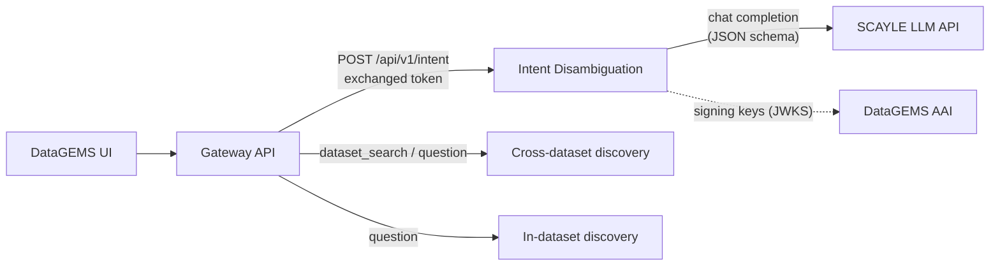
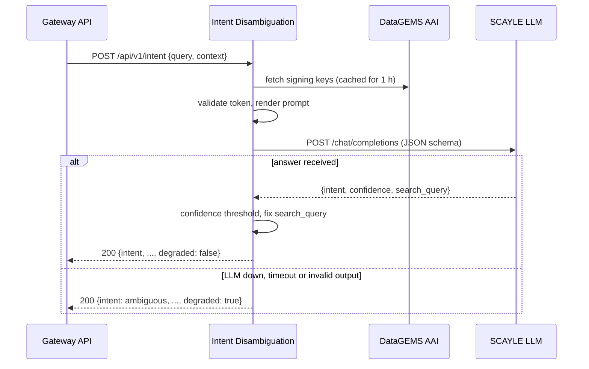

# Service Architecture

The Intent Disambiguation service is a small, stateless FastAPI application. It holds no
database or queue: every request is answered by one call to an LLM hosted on SCAYLE.

## High-Level Architecture

The Gateway owns the user-facing flow. It calls this service first, then runs the
discovery flow that matches the returned intent, and tells the UI which view to open.

## Component Details

### API Layer

`intent_disambiguation/main.py` builds the FastAPI application:

- `POST /api/v1/intent` classifies an input (`routes/intent.py`).
- `GET /`, `GET /monitoring/ready` and `GET /monitoring/health-check` serve the
  Kubernetes probes and diagnostics (`routes/health.py`).
- A middleware reads the `x-tracking-correlation` header (or creates an id), binds it to
  every log line as `DGCorrelationId`, echoes it in the response and writes one access log
  line per request.

Request and response models live in `schemas.py`. Validation errors are returned by
FastAPI as `422` responses.

### Authentication

`auth.py` validates DataGEMS AAI (Keycloak) bearer tokens: signature against the realm's
published keys, issuer, expiry, and optionally audience and calling client. It is switched
on with `ENABLE_AUTH`. See [Security](security.md).

### Classifier

`classifier.py` turns an input into an answer:

1. Loads the versioned prompt `prompts/intent_<version>.yaml` and renders its examples
   into the system message.
2. Renders the user message: the input inside `<input>` tags, followed by an optional
   `<context>` block with the topic filter, the number of selected datasets and the last
   five earlier messages.
3. Calls the LLM with temperature 0 and a strict JSON schema
   (`intent`, `confidence`, `search_query`).
4. Parses and validates the answer, applies the confidence threshold and fixes up
   `search_query`.
5. On any failure (connection, timeout, empty or invalid output) returns the
   [degraded answer](intent-classification.md#degraded-answers) instead of an error.

See [Intent Classification](intent-classification.md) for the details.

### SCAYLE Client

`llm/scayle.py` is a small async client for the OpenAI-compatible SCAYLE API:

- Exchanges the LDAP credentials for a bearer token (`POST /v1/auths/ldap`), caches it,
  and renews it once when a call returns `401`.
- Retries once on connection errors and on `502`, `503` and `504`.
- Applies a connect timeout of 5 s and a read timeout of `SCAYLE_TIMEOUT` (20 s).
- Sends `chat_template_kwargs.enable_thinking` to switch the model's reasoning phase
  on or off.

Credentials are never logged or included in error messages.

## Request Flow

## Design Decisions

- **Classify only.** Discovery calls, dataset filtering and the conversation stay in the
  Gateway, so this service has no state and can be scaled or replaced on its own.
- **Degrade, do not fail.** An LLM outage turns into `ambiguous` answers rather than
  `5xx` errors, so the home page keeps working and the user is asked to choose.
- **Thinking off by default.** With reasoning enabled the model is about as accurate but
  four times slower at the tail, and long reasoning can exhaust the token budget (see
  [Evaluation](evaluation.md#results)).
- **Prompts are data.** Each prompt version is a YAML file, selected by `PROMPT_VERSION`,
  so a new prompt can be evaluated side by side with the current one before it is
  switched on.
- **No heavy dependencies.** The image contains FastAPI, httpx, pydantic, structlog,
  PyJWT and PyYAML (about 230 MB) and starts in a couple of seconds.
